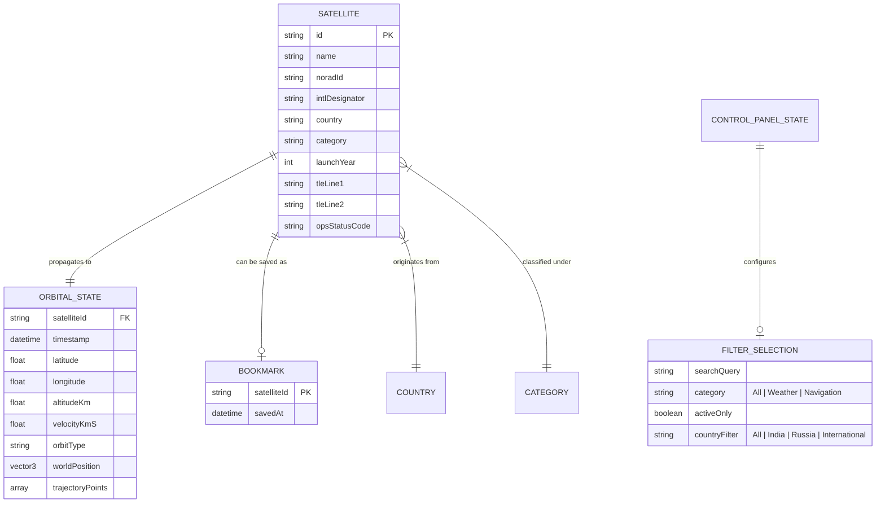

# Data Model: Core Satellite Tracking & Globe Experience

**Feature**: `001-core-satellite-tracking`  
**Date**: 2026-11-07  
**Status**: Draft

## Entities Overview



---

## Entity Details

### 1. `Satellite`
Represents a spaceborne tracked asset.

| Field | Type | Required | Description | Validation / Constraints |
|---|---|---|---|---|
| `id` | string | Yes | Unique canonical slug (e.g., `iss`, `insat-3d`, `cartosat-2a`, `resurs-p-4`) | Lowercase kebab-case |
| `name` | string | Yes | Display name (e.g. `ISS`, `INSAT-3D`, `Cartosat-2A`, `Resurs-P 4`) | Non-empty string |
| `noradId` | string | Yes | NORAD catalog number (e.g. `25544`, `32783`, `59371`) | Digits only |
| `intlDesignator` | string | Yes | International COSPAR ID (e.g. `1998-067A`, `2024-060A`) | Standard COSPAR format or `—` |
| `country` | string | Yes | Operating nation (`India`, `Russia`, `International`) | Valid enum string |
| `category` | string | Yes | Functional type (`Weather`, `Navigation`, `Communication`, `Earth Observation`, `Space Station`) | Valid enum string |
| `launchYear` | number \| null | No | Calendar year of orbital launch (e.g. `1998`, `2024`) | Valid 4-digit year or `null` (renders `—`) |
| `tleLine1` | string | Yes | First line of standard TLE | Valid 69-character TLE line 1 |
| `tleLine2` | string | Yes | Second line of standard TLE | Valid 69-character TLE line 2 |
| `opsStatusCode` | string | Yes | Raw SATCAT operational status code from live data (`+`, `-`, `P`, `B`, `D`) | Evaluated dynamically |

**Dynamic Operational Status Resolution**:
```typescript
function getOperationalStatus(opsStatusCode: string): "Active" | "Inactive" | "—" {
  if (opsStatusCode === "+" || opsStatusCode === "P" || opsStatusCode === "B") return "Active";
  if (opsStatusCode === "-" || opsStatusCode === "D") return "Inactive";
  return "—";
}
```

---

### 2. `OrbitalState`
Real-time continuously computed orbital telemetry for a specific instant in time ($t$).

| Field | Type | Required | Description | Fallback Behavior |
|---|---|---|---|---|
| `satelliteId` | string | Yes | Target satellite identifier | None |
| `timestamp` | Date | Yes | Exact UTC timestamp of propagation | Current system time |
| `latitude` | number \| null | Yes | Geodetic latitude (-90.0 to +90.0) | `null` $\rightarrow$ `—` |
| `longitude` | number \| null | Yes | Geodetic longitude (-180.0 to +180.0) | `null` $\rightarrow$ `—` |
| `altitudeKm` | number \| null | Yes | Altitude above Earth sea level in km | `null` $\rightarrow$ `— km` |
| `velocityKmS` | number \| null | Yes | Orbital velocity in km/s | `null` $\rightarrow$ `— km/s` |
| `orbitType` | string | Yes | Calculated orbit regime (`LEO`, `GEO`, `MEO`, `HEO`) | `null` $\rightarrow$ `—` |
| `worldPosition` | `{ x: number, y: number, z: number }` | Yes | 3D Cartesian coordinates in WebGL world space | Normalized relative to Earth sphere radius |
| `trajectoryPoints` | `Array<{ x: number, y: number, z: number }>` | Yes | Array of 3D points representing the trailing orbit path | Rendered as amber line |

---

### 3. `Bookmark`
User-saved satellite records stored in client-side persistence.

| Field | Type | Description |
|---|---|---|
| `satelliteId` | string | References `Satellite.id` |
| `savedAt` | number | Unix timestamp (epoch ms) when bookmarked |

**Persistence Contract**:
- Key: `satellite_tracker_saved_ids`
- Storage: `window.localStorage`
- Format: JSON array of string IDs (e.g. `["iss"]`)

---

### 4. `FilterSelection`
Represents the control panel filtering state machine.

| Field | Type | Default | Description |
|---|---|---|---|
| `searchQuery` | string | `""` | User-entered search substring (case-insensitive against name and designator) |
| `category` | `"All" \| "Weather" \| "Navigation"` | `"All"` | Single-select primary functional category |
| `activeOnly` | boolean | `false` | When true, excludes satellites whose operational status is `Inactive` |
| `country` | `"All" \| "India" \| "Russia" \| "International"` | `"All"` | Country-based filtering facet |
